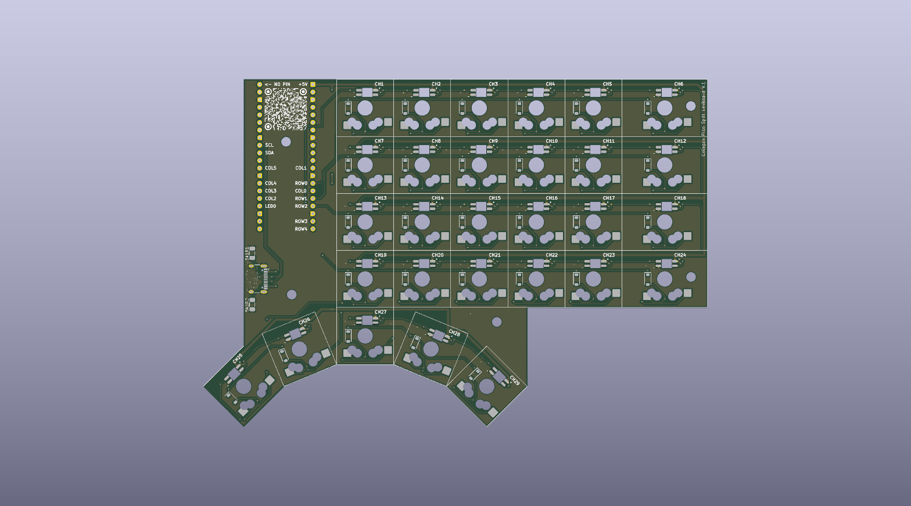
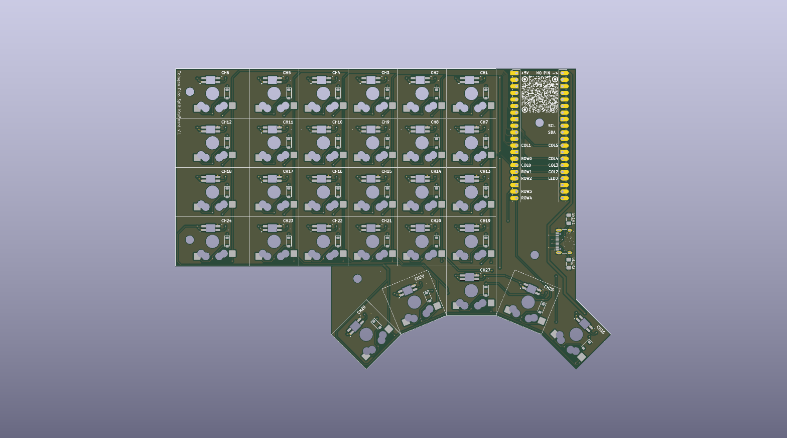

# Matériel — Colagan Pico Split KeyBoard V2

Sources KiCad (9.0) du PCB réversible tel que fabriqué chez JLCPCB (novembre 2025) : 29 touches Gateron KS-33 low profile en hot-swap, une LED SK6812 mini-e et une diode par touche, Raspberry Pi Pico (W), USB-C 16 broches. Le même circuit sert pour les deux moitiés, en le retournant.

## Ouvrir le projet

Ouvrir `kicad/SplitKeyboard Colagan V2.kicad_pro` avec KiCad 9. Le fichier `fp-lib-table` déclare la bibliothèque d'empreintes du projet (`Library SplitKeyboard Colagan`), donc rien à configurer. Les symboles sont embarqués dans le schéma ; les bibliothèques standard de KiCad (`Connector`, `MCU_Module_RaspberryPi_Pico`, `power`, `MountingHole`) viennent de l'installation.

| Fichier | Contenu |
|---|---|
| `kicad/SplitKeyboard Colagan V2.kicad_{pro,sch,pcb}` | Projet principal (version fabriquée, 04/11/2025) |
| `kicad/Library SplitKeyboard Colagan.pretty/` | Toutes les empreintes personnalisées (voir ci-dessous) |
| `kicad/fp-lib-table` | Table de bibliothèques du projet |
| `kicad/fabrication-toolkit-options.json` | Options du plugin de fabrication |
| `images/` | Rendus 3D (face, dos), cuivre avant/arrière et schéma en SVG, générés avec `kicad-cli` |
| `3d/` | Export STEP et 3MF de la V1 (ancienne révision) |

Les anciennes sources (révision du 20/10/2025, variante OLED, captures) ne sont plus dans le dépôt : elles sont dans l'historique git.

## Empreintes (`Library SplitKeyboard Colagan.pretty`)

### Utilisées dans le PCB

| Empreinte | Rôle | Quantité |
|---|---|---|
| `KS33-HS-Colagan-1U-Final` | Touche 1U : interrupteur KS33 hot-swap, LED SK6812 mini-e, diode ; réversible (deux faces) | 25 |
| `KS33-HS-Colagan-1.5U-Final` | Même chose pour la colonne extérieure 1,5U | 4 |
| `RaspberryPi_Pico_Colagan_REF3` | Support du Raspberry Pi Pico | 1 |
| `USB_C_16P-Reversible-colagan` | Connecteur USB-C 16 broches (alimentation et lien série entre les moitiés) | 1 |
| `Capasitor_SMD_1206_Reversible_ColaganV3` | Résistances 5,1 kΩ de CC1/CC2 (R1, R2), réversibles | 2 |
| `qrcode github` | QR code du projet, en sérigraphie/cuivre | 1 |

La touche KS33 intègre trois composants en un seul placement : c'est une empreinte combinée, pas une empreinte d'interrupteur seule. Broches : 1 colonne, 2 et 3 ligne (via la diode), 4 +5V, 5 DIN de la LED, 6 GND, 7 DOUT de la LED.

### Versions intermédiaires et illustrations

- `Capasitor_*` autres que V3, `SOT-23-5-Reversible-*`, `USB_C_6P_Colagan`, `OLED_SSD1306_128x32_4pin`, `RaspberryPi_Pico_Colagan`, `_REF`, `_REF2` : itérations précédentes, non utilisées dans la V2.
- `Gengar*`, `Gengar_Souls.kicad_sym`, `fantominus*`, `spectrum 35mm` : illustrations de sérigraphie / cuivre (empreintes « LOGO »).

## Modèles 3D

Les empreintes référencent des modèles 3D qui **ne sont pas dans ce dépôt** :

- le modèle Gateron KS-33 low profile (`GateronKS-33LowProfile-3D/*.stp`, fourni par le fabricant) ;
- le modèle du switch de la bibliothèque `marbastlib` d'ebastler (installée via le gestionnaire de plugins de KiCad) ;
- un modèle `SK6812-E.step` stocké localement ;
- les modèles du Pico de la bibliothèque standard de KiCad.

Les empreintes fonctionnent sans eux ; seul l'affichage 3D dans KiCad en dépend. Le dossier `3d/` contient un export complet de la carte.

## Électronique

- **Matrice** : colonnes `Col0`–`Col5`, rangées `Row0`–`Row4`, diodes sur les touches. Brochage du Pico : colonnes GP20, GP22, GP12, GP11, GP10, GP9 ; rangées GP21, GP19, GP18, GP17, GP16 ; LEDs GP13.
- **LEDs** : chaîne linéaire, LED n = touche CH(n+1) (CH1 à CH29, de gauche à droite sur chaque rangée). Alimentées en 5 V.
- **Signal LED** : la ligne de données du Pico (3,3 V) attaque directement la première LED, sans convertisseur de niveau ni résistance (validé sur les deux moitiés, LED alimentées en 5 V). Les sources V2 n'ont pas de U3 ni de 4k7.
- **USB-C** : prise `J2` 16 broches (V2), avec deux résistances de 5,1 kΩ (R1, R2) sur CC1/CC2. Les broches de données D+/D- (A6/B6, A7/B7) sont reliées directement aux signaux `SCL` et `SDA` : c'est le lien série entre les deux moitiés.
- **Géométrie** : grille 6×4 au pas de 19,05 mm ; colonne extérieure 1,5U ; cinq pouces CH25–CH29 en arc (rotations 45°, 22,5°, 0°, −22,5°, −45° dans KiCad).

Brochage de la moitié gauche (carte retournée) : voir la section de montage ci-dessous. Détails lus sur le PCB V2 et validés sur les deux moitiés en octobre 2026.

## Non inclus

Les exports STEP lourds, les modèles 3D du switch, les Gerbers de fabrication et les sauvegardes automatiques de KiCad.

## Licence

Aucune licence matérielle n'est encore déclarée pour ces fichiers.

## Montage de la moitié gauche (retournée)

Le PCB est réversible : la gauche est la même carte retournée, avec le Pico dans le même sens. Conséquences vérifiées en octobre 2026 :
- Les étiquettes `NO PIN` et `+5V` sont inversées côté gauche. Les deux trous sont sur le rail 5 V : souder VBUS (broche 40 du Pico) dans l'un, ne jamais souder GP0 (broche 1) dans l'autre, sous peine d'injecter 5 V dans un GPIO.
- Le brochage est le miroir de la droite : LED sur GP18 (GP13 à droite), matrice colonnes GP11, GP9, GP19, GP20, GP21, GP22 et lignes GP10, GP12, GP13, GP14, GP15, lien série sur GP26.
- SK6812 mini-E : la broche marquée de la LED est le GND, pas le VDD. Souder à la pâte a donné des contacts intermittents, mieux vaut un fer.
- Diodes : cathode côté ligne (`COL2ROW`), le sens visuel est inversé d'une face à l'autre.
